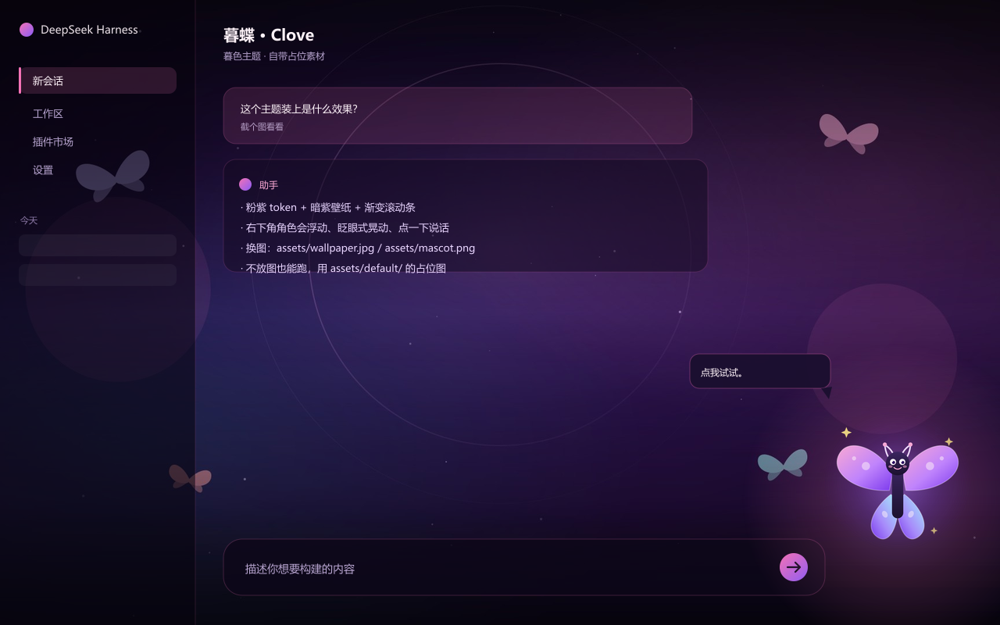

# dsh-theme-clove

暮色调的 DeepSeek Harness Web GUI 主题：粉紫配色、暗紫壁纸，还有右下角一只会动的小角色。

仓库里**不带**任何同人图。默认用 `assets/default/` 下一张原创的蝴蝶占位图，装好就能跑；想换成你喜欢的图，往下看「换成自己的图」。



## 它会改什么

- 33 个 design token：深紫半透明表面、蝶粉强调色、粉紫渐变滚动条
- 整页壁纸（`body` 固定背景），聊天输入卡圆角和内描边
- 右下角角色：浮动、呼吸、光晕、随机晃动、鼠标视差，点一下会跳起来说句话
- 全部挂在插件 fiber 上，禁用或卸载后页面干净还原
- 窄屏隐藏角色，`prefers-reduced-motion` 下关掉动画

## 安装

```
dsh plugin --profile web-desktop add github:<你的用户名>/dsh-theme-clove
```

或者本地开发：

```
git clone https://github.com/<你的用户名>/dsh-theme-clove
dsh plugin --profile web-desktop add link:D:\path\to\dsh-theme-clove
```

装完重启客户端（或 `dsh web`）并强刷页面。卸载用 `dsh plugin --profile web-desktop remove dsh-theme-clove`。

## 换成自己的图

插件优先读 `assets/` 下的两张图，读不到才回退到 `assets/default/`：

| 文件 | 规格 |
| --- | --- |
| `assets/wallpaper.jpg` | 1920×1080，JPEG |
| `assets/mascot.png` | 透明底 PNG，高 300–500px，底部渐隐效果更好 |

放好后重启并强刷即可。壁纸/角色路径写在 `host.js` 的 `ASSETS` 和 `client.js` 的 `MASCOT_SRC` 里，想换目录改这两处。

## 改点别的

- 配色：`client.js` 里的 `TOKENS`，每项是 `{ light, dark }`
- 台词：`client.js` 里的 `LINES`
- 角色大小/位置：CSS 变量 `--clove-size`，以及 `.dsh-clove-mascot` 的 `right` / `bottom`
- 动画节奏：`clove-float`、`clove-breath`、`clove-hop`、`clove-wiggle`、`clove-glow` 几个 keyframes

## 结构

```
host.js            # 静态资源路由（壁纸、角色图），带默认图回退
client.js          # 设计 token、CSS、角落角色的挂载与动画
assets/default/    # 占位素材（原创）
cordis.patch.yml   # 插件行
test/              # 两个零依赖冒烟测试
```

## 测试

```
npm test
node test/host-smoke.mjs
```

浏览器半区跑在最小 DOM stub 上，宿主半区真的读文件并校验字节头，不需要启动 dsh。

## 已知限制

- 壁纸和毛玻璃按 Chromium 打磨，Firefox 下效果打折
- 一个 profile 只建议开一个主题插件，token 是叠加的
- 静态路由缓存 1 小时，换图后强刷

## 许可

代码 MIT。`assets/default/` 里的占位图是原创的，随代码一起按 MIT 使用。

「暮蝶 / Clove」和 VALORANT 是 Riot Games 的商标，本仓库与 Riot 无关，也不分发官方素材。想用同人图的话请自行取得原作者授权，并只在本地使用。

---

A dusk-themed skin for the DeepSeek Harness web GUI: 33 design tokens, a wallpaper, and a small floating mascot with idle animations and a click reaction. The repo ships original placeholder art; drop your own `assets/wallpaper.jpg` and `assets/mascot.png` to replace it. MIT licensed. Not affiliated with Riot Games.
